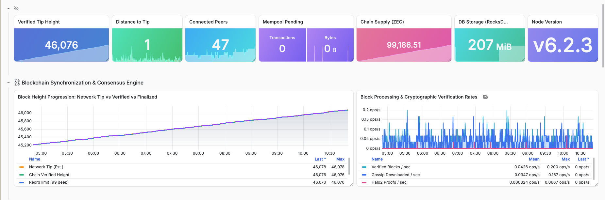
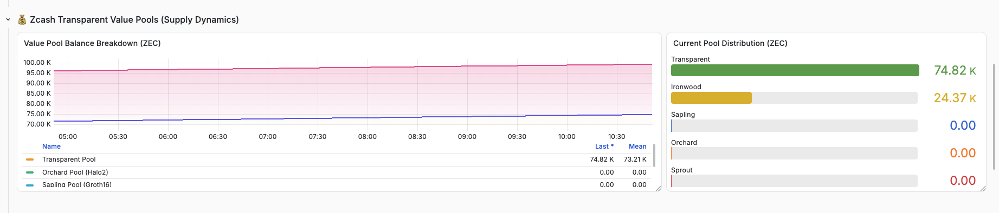
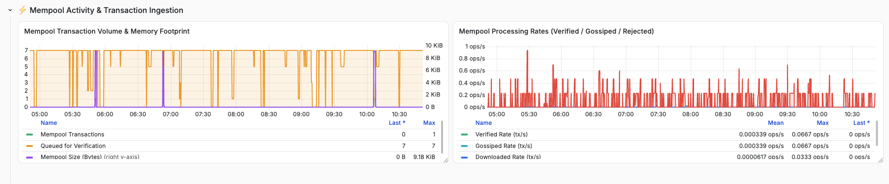
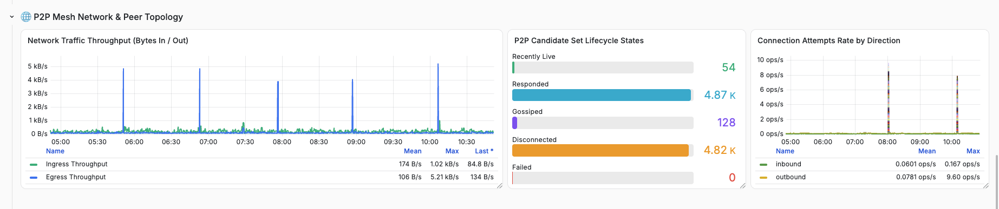
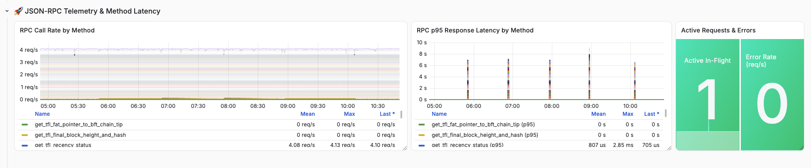
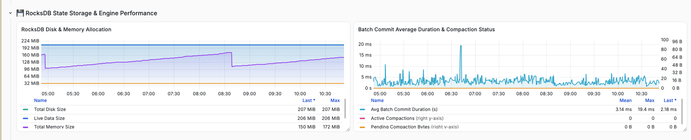

# zcash-crosslink-monitoring
Grafana dashboards and alerting rules for running a Zcash Crosslink finalizer and node, by Encapsulate.



## 📂 Repository Contents

```bash
.
├── images/                     # Dashboard screenshots
├── zcash-node-dashboard.json   # Ready-to-import Grafana Dashboard
├── zcash-node-alerts.yml       # Prometheus alerting rules
└── README.md                   # Documentation & Deployment Guide
```

## Setup

### 1. Enable node metrics
Add a `[metrics]` section to `zebrad.toml` and restart the node:

```toml
[metrics]
endpoint_addr = "0.0.0.0:9999"
```

The node then serves Prometheus metrics at `http://<node>:9999/metrics`.

### 2. Scrape the node and load the alerting rules
In `prometheus.yml`, add a scrape job and point `rule_files` at the alerts file. The `ZcashNodeDown` alert expects the job to be named `zcash`.

```yaml
rule_files:
  - /etc/prometheus/rules/zcash-node-alerts.yml

scrape_configs:
  - job_name: zcash
    static_configs:
      - targets: ["<node>:9999"]
```

Check the rules with `promtool check rules zcash-node-alerts.yml`, then reload Prometheus.

## Import Grafana Dashboard
1. Open your Grafana instance.
2. Navigate to **Dashboards** → **New** → **Import Dashboard**.
3. Upload [`zcash-node-dashboard.json`](zcash-node-dashboard.json) or paste its contents.
4. Select your Prometheus data source from the dropdown.
5. Click **Import**!

## Dashboard Sections

### Value Pools


### Mempool


### P2P Network


### JSON-RPC


### RocksDB Storage

